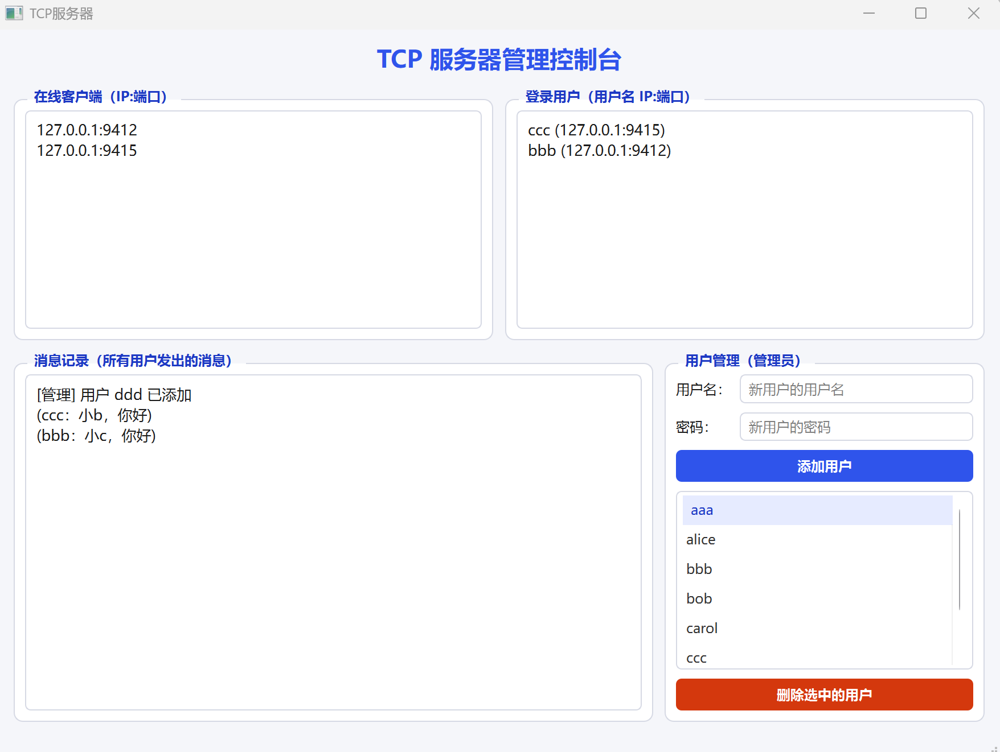
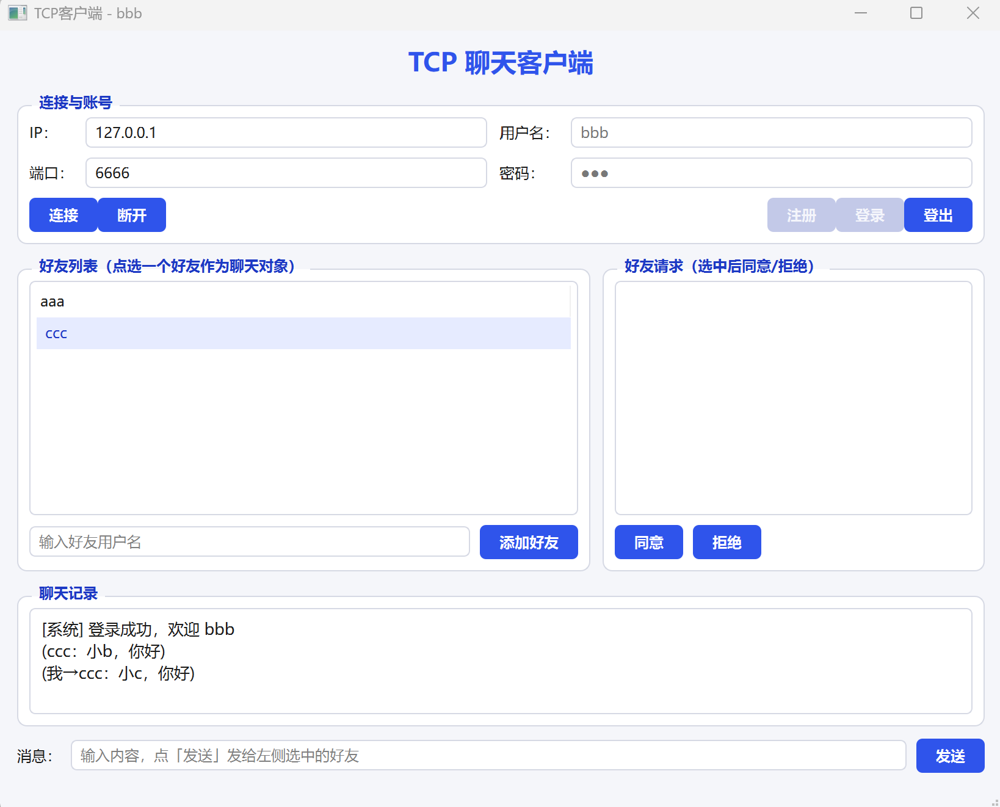

# TcpServer-Client — Qt6 TCP 聊天室（服务器 + 客户端）

基于 **Qt 6 / Widgets / QtNetwork** 的一对桌面程序：服务端做连接管理与账号体系，客户端做注册登录、好友、私聊。

配套项目：[AOMonitor](https://github.com/carson631/AOMonitor)（STM32 光照采集上位机）。

---

## 下载即用（Windows x64 免安装）

不想编译就直接下打好的包，**已内置 Qt 运行库，解压双击即可运行**：

| 下载 | 大小 | 说明 |
|---|---|---|
| [TcpServer-1.1.0-win64.zip](https://github.com/carson631/TcpServer-Client/releases/download/v1.1.0/TcpServer-1.1.0-win64.zip) | ~25 MB | 服务端 **v1.1.0**：多线程 + MySQL 持久化 |
| [TcpServer-1.0.0-win64.zip](https://github.com/carson631/TcpServer-Client/releases/download/v1.0.0/TcpServer-1.0.0-win64.zip) | 23.5 MB | 服务端 v1.0.0（旧版，文件存账号） |
| [TcpClient-1.0.0-win64.zip](https://github.com/carson631/TcpServer-Client/releases/download/v1.0.0/TcpClient-1.0.0-win64.zip) | 23.4 MB | 客户端，可多开（每实例一个账号） |

全部发布版本见 [Releases](https://github.com/carson631/TcpServer-Client/releases)。

快速开始：解压服务端 → 双击 `TCPServer.exe`（防火墙弹窗选「允许」）→ 解压客户端 → 双击 `TCPClient.exe` → IP 填 `127.0.0.1`、端口 `6666` → 连接 → 注册 / 登录 → 互加好友 → 私聊。

> 国内网络如果打不开下载链接，在地址前加 `https://gh-proxy.com/` 即可，例如：
> `https://gh-proxy.com/https://github.com/carson631/TcpServer-Client/releases/download/v1.0.0/TcpClient-1.0.0-win64.zip`

---

## 界面预览

**服务端 · TCP 服务器管理控制台**（在线客户端、登录用户、消息记录、用户管理）



**客户端 · TCP 聊天客户端**（连接登录、好友列表、好友请求、私聊记录）



---

## 目录结构

```
TcpServer-Client/
├── docs/                 # 界面截图
├── TCPServer/            # 服务端 v1.1.0：监听 6666，MySQL 持久化
│   ├── CMakeLists.txt    #   构建后自动部署 MySQL 运行时（见文件内注释）
│   ├── main.cpp
│   ├── mainwindow.h/.cpp/.ui
│   ├── mythread.h/.cpp       # 每连接一个工作线程
│   ├── mytcpserver.h/.cpp    # 重写 incomingConnection 只抛描述符
│   ├── database.h/.cpp       # Database 单例：MySQL 连接 + 预处理语句
│   ├── sql/schema.sql        # 建库建表 + 应用账号
│   ├── tools/                # 数据库排障小程序
│   ├── docs/                 # 服务端截图
│   └── README.md             # 服务端详细说明（含 "Driver not loaded" 排障）
└── TCPClient/            # 客户端：连接、注册登录、好友、私聊
    ├── CMakeLists.txt
    ├── main.cpp
    ├── mainwindow.h/.cpp/.ui
    ├── start_multi_client.bat   # 一键多开客户端（测试用）
    └── TCPClient_zh_CN.ts
```

## 功能

### 服务端（TCPServer）

| 功能 | 说明 |
|---|---|
| 多线程接入 | 重写 `incomingConnection()` 只抛 socket 描述符，**每个连接一个工作线程**（`MyThread::run()` 阻塞轮询，跨线程发送走互斥队列） |
| MySQL 持久化 | 用户 / 消息 / 好友关系存 MySQL（默认 `192.168.5.50:3306/tcp_chat`，界面可改，`QSettings` 记忆）；连不上自动重试 6 次×5s |
| 在线客户端 / 登录用户 | 两个只读区实时刷新 `IP:端口` 与 `用户名 (IP:端口)` |
| 账号体系 | 密码只存 **SHA-256** 摘要；首次连库自动建库建表，并把老的 `users.txt` / `friends.txt` 迁移进去 |
| 好友关系 | `friends` 表双向记录（按对方去重统计），登录时自动下发；请求须对方在线，同意/拒绝即时通知双方 |
| 私聊路由 | 校验好友关系 + 在线状态后转发；服务器界面按 `(用户名：消息)` 全量留底，同时写 `messages` 表 |
| 用户管理 | **QTableView 管理面板**（数据来自 MySQL，按用户名模糊查询，增删/上下线/发消息实时刷新）；添加用户、删除选中用户（踢下线 + 清除好友关系） |

### 客户端（TCPClient）

- 串口外的一切：连接/断开、注册、登录、登出（按钮可用性随登录状态自动切换）
- 好友列表点选即收件人；好友请求列表选中后同意/拒绝
- 私聊收发，自己发的回显为 `(我→好友：内容)`，收到的显示为 `(好友：内容)`
- 标题栏随状态变化：未连接 `TCP客户端` → 已连接显示本端 `IP:端口` → 已登录显示 `TCP客户端 - 用户名`
- 关闭窗口静默断开（`m_closing` 标志跳过提示框），点「断开」才提示

## 协议

TCP 是字节流，没有消息边界，所以用**行帧**：每条以 `\n` 结尾，字段用 `|` 分隔。两端都实现了半包缓冲（`m_buffer` 按 `\n` 拆帧，不完整就留到下次）。

客户端 → 服务器：

```
REG|用户名|密码          注册
LOG|用户名|密码          登录
OUT                      登出
ADD|好友用户名           发好友请求（对方须在线）
AGREE|好友用户名         同意请求
REFUSE|好友用户名        拒绝请求
PMSG|好友用户名|内容     私聊
```

服务器 → 客户端：

```
REG_OK|用户名        REG_FAIL|原因
LOG_OK|用户名        LOG_FAIL|原因
OUT_OK               ERR|原因
FRIENDS|好友1,好友2,...      登录后 / 关系变化时推送
ADD_REQ|发起者  ADD_OK|对方  ADD_FAIL|原因  ADD_REJECT|对方
AGREE_OK|对方   REFUSE_OK|对方
PMSG|发送者|内容  PMSG_FAIL|原因
```

## 依赖

- Qt **6.5+**（开发使用 6.8.3 LTS），模块：`Core`、`Widgets`、**`Network`**
- CMake ≥ 3.19 + Ninja（或 MinGW Makefiles / Make）
- Windows：MinGW 13.1 64-bit 或 MSVC；Linux：GCC

## 编译

### Qt Creator

分别打开 `TCPServer/CMakeLists.txt` 与 `TCPClient/CMakeLists.txt`，Kit 选 `Desktop Qt 6.8.3 MinGW 64-bit`，`Ctrl+B` 构建、`Ctrl+R` 运行。

### 命令行

```bash
export PATH="/c/Program Files/CMake/bin:/d/Qt/Tools/mingw1310_64/bin:/d/Qt/6.8.3/mingw_64/bin:$PATH"

cd TCPServer
cmake -S . -B build -G Ninja -DCMAKE_BUILD_TYPE=Release -DCMAKE_PREFIX_PATH=D:/Qt/6.8.3/mingw_64
cmake --build build

cd ../TCPClient
cmake -S . -B build -G Ninja -DCMAKE_BUILD_TYPE=Release -DCMAKE_PREFIX_PATH=D:/Qt/6.8.3/mingw_64
cmake --build build
```

### Linux

```bash
sudo apt install -y build-essential cmake ninja-build qt6-base-dev libgl1-mesa-dev
cmake -S . -B build-linux -DCMAKE_BUILD_TYPE=Release && cmake --build build-linux -j$(nproc)
```

> Windows 与 Linux 的构建目录不可混用（`CMakeCache.txt` 存绝对路径）。

## 运行与测试

1. 启动 `TCPServer.exe`，窗口标题显示监听状态，服务端监听 `0.0.0.0:6666`
2. 启动客户端，IP 填 `127.0.0.1`（同机测试）或服务器局域网 IP，端口 `6666`，点「连接」
3. 用两个客户端分别注册/登录两个账号（如 `alice` / `bob`）
4. A 输入对方用户名点「添加好友」→ B 在好友请求列表选中后点「同意」
5. 选中好友 → 输入内容 → 发送，双方即时收到

**多开客户端**：双击 `TCPClient/start_multi_client.bat`（默认 2 个实例），或 `start_multi_client.bat 5`。

**运行库**：若双击 exe 报「无法定位程序输入点 / 缺少 Qt6Core.dll」，在构建目录执行：

```bash
windeployqt --compiler-runtime TCPServer.exe
windeployqt --compiler-runtime TCPClient.exe
```

## 数据存储（v1.1.0 起为 MySQL）

服务端把数据存进 MySQL（库 `tcp_chat`，表 `users` / `messages` / `friends`，
详见 [TCPServer/README.md](TCPServer/README.md) 与 [TCPServer/sql/schema.sql](TCPServer/sql/schema.sql)）：

- 界面顶栏可改主机 / 端口 / 库名 / 账号密码，`QSettings` 记忆，支持环境变量覆盖
- 首次连库自动 `CREATE DATABASE` / `CREATE TABLE IF NOT EXISTS`
- 老版本的 `users.txt` / `friends.txt`（如存在）会在首次连库时自动迁移进数据库

**Windows 侧 Qt 官方包不含 MySQL 驱动**，需安装社区预编译版
`thecodemonkey86/qt_mysql_driver`，且 exe 旁必须同时有
`libmysql.dll` / `libcrypto-3-x64.dll` / `libssl-3-x64.dll` 和
`sqldrivers\qsqlmysql.dll`——本项目 CMake 已做成构建后自动部署，
原理与排障见 [TCPServer/README.md](TCPServer/README.md) 的
「Driver not loaded 怎么来的」一节。发布包内已内置全部运行库。

## 已知限制

- 密码未加盐，学习项目够用；生产环境应改用 bcrypt/Argon2 并加盐
- 好友请求只存内存（`m_pendingReq`），对方离线时无法发起
- 无 TLS、无管理员鉴权：服务端管理界面是本机 GUI 操作，不开放远程管理
- 服务端监听端口默认 6666；MySQL 连接参数在界面顶栏可改（`QSettings` 持久化）

## License

个人学习项目，可自由参考。
