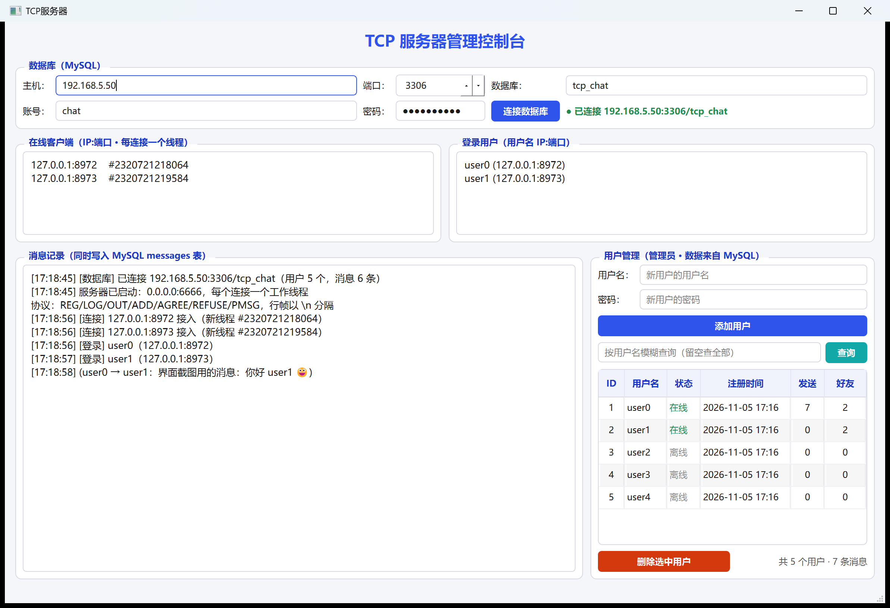

# TCPServer — 多线程 TCP 聊天服务器（Qt 6 + MySQL）

基于 Qt 6 Widgets 的服务器端程序：**每个客户端一个工作线程**，用户、好友、消息全部存进
Ubuntu 虚拟机里的 MySQL，管理界面用 `QTableView` 展示查询结果，增删用户后表格实时刷新。



---

## 1. 结构：线程负责收发，主线程负责业务

```
        ┌──────────── 主线程 ────────────┐
 客户端   │  MyTcpServer.incomingConnection │
   │      │        │ qintptr 描述符        │
   │      │        ▼                      │
   │      │   new MyThread(sd) → start()  │
   │      └────────┬──────────────────────┘
   │               │ 每个连接一条线程
   ▼               ▼
 socket ◄──► MyThread::run()     阻塞 waitForReadyRead(20ms)
                  │
                  │ 自定义信号（跨线程自动排队）
                  │  sigConnected / sigLine / sigDisconnected / sigError
                  ▼
          MainWindow 槽函数：解析协议 + 读写 MySQL + 刷新界面
```

| 文件 | 职责 |
|---|---|
| `mytcpserver.h/.cpp` | 重写 `incomingConnection(qintptr)`，只把 socket 描述符抛出去，不自己建 socket |
| `mythread.h/.cpp` | **`MyThread : QThread`，重写 `run()`**：接管描述符、循环收数据、按 `\n` 切帧、发信号 |
| `database.h/.cpp` | MySQL 访问层（预处理语句、事务、自动建库建表） |
| `mainwindow.h/.cpp` | 协议解析、业务逻辑、界面刷新 |

### 两个关键设计

**① `QTcpSocket` 不能跨线程，所以用 `incomingConnection` 而非 `newConnection`。**
`newConnection` 触发时 `QTcpServer` 已经自己 `new` 了一个 socket，那个对象只能留在主线程。
重写 `incomingConnection(qintptr)` 后，我们在子线程的 `run()` 里
`socket.setSocketDescriptor(sd)` 接管，这是 Qt 文档里多线程服务器的标准做法。

**② 发数据是「主线程入队、工作线程写出」。**
`QTcpSocket` 不是线程安全的，主线程不能直接 `write()`。`MyThread::sendLine()` 把内容加进
`QStringList`（`QMutex` 保护），`run()` 每轮循环先清空队列再等数据，
等待用 `waitForReadyRead(20)`，所以发送延迟不超过 20 ms。

**③ 数据库只走主线程。**
`QSqlDatabase` 的连接不能跨线程共享。业务逻辑和 SQL 全部回到主线程执行，
既不用给每个线程开连接，也不会有事务互相踩的问题。

### 自定义信号

| 信号 | 参数 | 时机 |
|---|---|---|
| `sigConnected` | `MyThread*, QString peer` | 线程接管连接成功 |
| `sigLine` | `MyThread*, QString line` | 收到完整一行（已去掉 `\n`） |
| `sigDisconnected` | `MyThread*, QString peer` | 对端断开 |
| `sigError` | `MyThread*, QString message` | 接管/socket 异常 |

`MyThread*` 需要在构造时 `qRegisterMetaType<MyThread*>("MyThread*")`，
否则队列连接传不过去。

---

## 2. 数据库

### 表

| 表 | 用途 | 关键字段 |
|---|---|---|
| `users` | 账号 | `username` 唯一、`pass_hash` 存 SHA-256、`online` 在线标记 |
| `messages` | 私聊记录 | `sender` / `receiver` / `content` / `sent_at` |
| `friends` | 好友关系 | `(user_a, user_b)` 主键，双向各一行 |

建表脚本见 [`sql/schema.sql`](sql/schema.sql)。程序启动时也会自动
`CREATE TABLE IF NOT EXISTS`，并且如果目标库不存在会自动 `CREATE DATABASE`。

### Ubuntu 虚拟机里装 MySQL

```bash
sudo apt update
sudo apt install -y mysql-server

# 允许远程连接（默认只监听 127.0.0.1）
sudo sed -i 's/^bind-address.*/bind-address = 0.0.0.0/' /etc/mysql/mysql.conf.d/mysqld.cnf
sudo systemctl restart mysql

# 建库建表 + 应用账号
sudo mysql < sql/schema.sql
sudo mysql -e "SELECT user,host FROM mysql.user WHERE user='chat';"
```

虚拟机网络要设成 **桥接** 或 **端口转发 3306**，宿主机才能连上。
本项目实测环境：VirtualBox + Ubuntu 24.04，IP `192.168.5.50`。

> 时区小提示：Ubuntu 默认 UTC，`sudo timedatectl set-timezone Asia/Shanghai`
> 并重启 mysql 后，`created_at` / `sent_at` 才是本地时间。

### Windows 侧的 MySQL 驱动

Qt 官方安装包**不含** QMYSQL 插件（授权原因）。项目用的是社区预编译版：

```
qsqlmysql.dll  →  D:\Qt\6.8.3\mingw_64\plugins\sqldrivers\
libmysql.dll   →  D:\Qt\6.8.3\mingw_64\bin\
libcrypto-3-x64.dll  →  D:\Qt\6.8.3\mingw_64\bin\
libssl-3-x64.dll     →  D:\Qt\6.8.3\mingw_64\bin\
```

来源：<https://github.com/thecodemonkey86/qt_mysql_driver/releases/tag/qmysql_6.8.3>
（选 `MinGW_13.1_64-bit`，与本机 Qt 6.8.3 + MinGW 13.1 匹配）。
那三个 DLL 必须和 `qsqlmysql.dll` 配套，否则连 MySQL 8 会报
`caching_sha2_password` 认证失败。

验证驱动是否生效：

```cpp
qDebug() << QSqlDatabase::drivers();   // 应包含 QMYSQL
```

### 「Driver not loaded」怎么来的（重要）

现象：程序能正常启动、服务器也能监听 6666，但日志一直刷

```
[数据库] 连接失败：Driver not loaded Driver not loaded
```

原因不是驱动没装，而是 **Qt 加载插件时的 DLL 搜索路径是受限的**：加载
`qsqlmysql.dll` 时，它的依赖 `libmysql.dll` 只会在 ①插件所在目录
②exe 所在目录 ③System32 里找，**不会去查 PATH**。所以即使
`D:\Qt\...\bin` 在 PATH 里，只要 exe 旁边没有 `libmysql.dll`，插件就加载
失败，Qt 报的错就是 `Driver not loaded`（`QSqlDatabase::drivers()` 里
甚至看不到 QMYSQL）。

还有第二个坑：官方 Qt 的插件目录依赖 `bin\qt.conf`（内容 `Prefix=..`）
相对于 `Qt6Core.dll` 的位置解析。一旦 `Qt6Core.dll` 被拷到别处（比如
构建目录的散装部署），插件目录就会算错，**连 QSQLITE 都不会出现在驱动
列表里**。

正确做法（`CMakeLists.txt` 里已做成 POST_BUILD 自动执行，每次构建后自动
把文件摆到 exe 旁边，无需手工拷）：

```
<构建目录>\TCPServer.exe
<构建目录>\Qt6Sql.dll
<构建目录>\libmysql.dll / libcrypto-3-x64.dll / libssl-3-x64.dll
<构建目录>\sqldrivers\qsqlmysql.dll      ← 插件放这里，exe 目录永远被扫描
```

自检办法：在构建目录跑一个小程序打印 `QSqlDatabase::drivers()`，正常应看到
`QSQLITE,QMIMER,QMARIADB,QMYSQL,QODBC,QPSQL`；为空就是插件目录没找到，
只有一部分就是插件本身的依赖没找到。

### 连接参数

界面顶部可以改，也会被 `QSettings` 记住；也支持环境变量覆盖（方便脚本化）：

| 环境变量 | 默认值 |
|---|---|
| `TCPS_DB_HOST` | `192.168.5.50` |
| `TCPS_DB_PORT` | `3306` |
| `TCPS_DB_NAME` | `tcp_chat` |
| `TCPS_DB_USER` | `chat` |
| `TCPS_DB_PASS` | `chat123456` |
| `TCPS_LOG` | 空；设成文件路径则把日志同时写文件 |

启动时连不上会自动重试 6 次（每 5 秒），覆盖「虚拟机关着 / MySQL 还在启动」。

---

## 3. 界面

| 区域 | 内容 |
|---|---|
| 数据库 | 主机 / 端口 / 库名 / 账号 / 密码 + 连接按钮 + 状态胶囊（绿=已连接） |
| 在线客户端 | 每个连接的 `IP:端口` 和它所属的线程编号，直观看出「一连接一线程」 |
| 登录用户 | 已认证用户及其地址 |
| 消息记录 | 带时间戳的服务器日志（连接/登录/注册/好友/消息/数据库事件） |
| 用户管理 | 添加用户、**关键字查询**、`QTableView`、删除选中用户、统计信息 |

**QTableView 的实时性**：表格数据来自一条 SQL（`QSqlQueryModel::setQuery`）：

```sql
SELECT u.id AS `ID`, u.username AS `用户名`,
       CASE WHEN u.online = 1 THEN '在线' ELSE '离线' END AS `状态`,
       DATE_FORMAT(u.created_at, '%Y-%m-%d %H:%i') AS `注册时间`,
       (SELECT COUNT(*) FROM messages m WHERE m.sender = u.username) AS `发送`,
       (SELECT COUNT(DISTINCT CASE WHEN f.user_a = u.username THEN f.user_b
                                   ELSE f.user_a END)
          FROM friends f
         WHERE f.user_a = u.username OR f.user_b = u.username) AS `好友`
FROM users u WHERE u.username LIKE ?ORDER BY u.id
```

> `friends` 表是双向各存一行的（A|B 和 B|A 各一条），所以「好友」列必须按
> **对方** `COUNT(DISTINCT ...)` 去重，直接 `COUNT(*)` 会把 N 个好友数成 2N。
> 客户端协议走的 `friendsOf()` 用 `UNION` 天然去重，没有这个问题。

- **添加 / 注册 / 删除用户** → 写完数据库立刻 `refreshUserTable()`，表格马上多一行/少一行
- **登录 / 登出 / 断线** → 更新 `users.online` 后刷新，状态列在 `在线`（绿）/`离线`（灰）之间切换
- **发消息** → 用 400ms 的 `QTimer` 合并刷新，避免每条消息都重新查表

---

## 4. 协议

行帧：每条以 `\n` 结尾，字段用 `|` 分隔，UTF-8 编码。

**客户端 → 服务器**

| 命令 | 说明 |
|---|---|
| `REG\|用户名\|密码` | 注册 |
| `LOG\|用户名\|密码` | 登录 |
| `OUT` | 登出 |
| `ADD\|用户名` | 发好友请求（对方须在线） |
| `AGREE\|用户名` / `REFUSE\|用户名` | 同意 / 拒绝 |
| `PMSG\|用户名\|内容` | 私聊 |

**服务器 → 客户端**

`REG_OK` `REG_FAIL` `LOG_OK` `LOG_FAIL` `OUT_OK` `ERR`
`FRIENDS|好友1,好友2` `ADD_REQ` `ADD_OK` `ADD_FAIL` `ADD_REJECT`
`AGREE_OK` `REFUSE_OK` `PMSG|发送者|内容` `PMSG_FAIL`

---

## 5. 构建

```bash
cmake -S . -B build -G Ninja -DCMAKE_BUILD_TYPE=Release -DCMAKE_PREFIX_PATH=D:/Qt/6.8.3/mingw_64
ninja -C build
```

依赖：`Qt6::Core Widgets Network Sql`。监听 `0.0.0.0:6666`。

## 6. 已验证

用 5 个并发客户端跑过完整流程（`REG → LOG → ADD → AGREE → PMSG → OUT`）：

- 5 个客户端并发注册、各自独立线程，互不干扰
- 好友请求 / 同意 / 双向 `FRIENDS` 同步
- 消息带 emoji（`😀`）原样入库，`utf8mb4` 无乱码
- 非好友发消息被拒绝
- 5 条消息连发全部到达
- 数据库核对：用户 5 行、消息 7 行、好友关系 2 行（双向），时间戳为 +08:00
